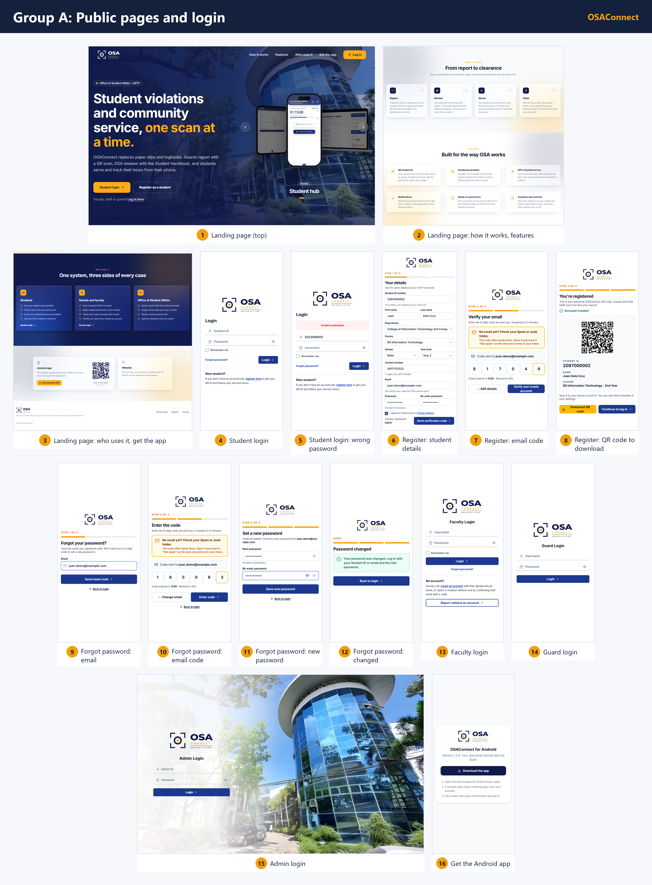

# Group A: Public pages and login

(1) The landing page is the first thing anyone sees: it explains that OSAConnect handles student violations and community service "one scan at a time" and shows the system on a phone, laptop and tablet, with buttons to log in or register. (2) Further down, it explains the four steps from report to clearance (report, review, serve, clear) and lists the main features. (3) It then shows what each user does (students, guards and faculty, and the Office of Student Affairs) and where to get the Android app or use the website. (4) A student logs in with their Student ID and password, and (5) a wrong password shows an "Invalid credentials" message. (6) A new student registers by filling in their details and agreeing to the Privacy Notice, (7) types the 6-digit code sent to their email, and (8) gets their personal QR code, which they download so guards can scan it. (9) If they forget their password, they enter their email, (10) type the code sent to it, (11) set a new password, and (12) see that the password was changed. (13) Faculty log in on their own page, where they can also create an account or report a violation without one, (14) guards log in on the guard page, and (15) OSA staff log in on the admin page. (16) Finally, the Android download page lets students, guards and faculty install the app.
