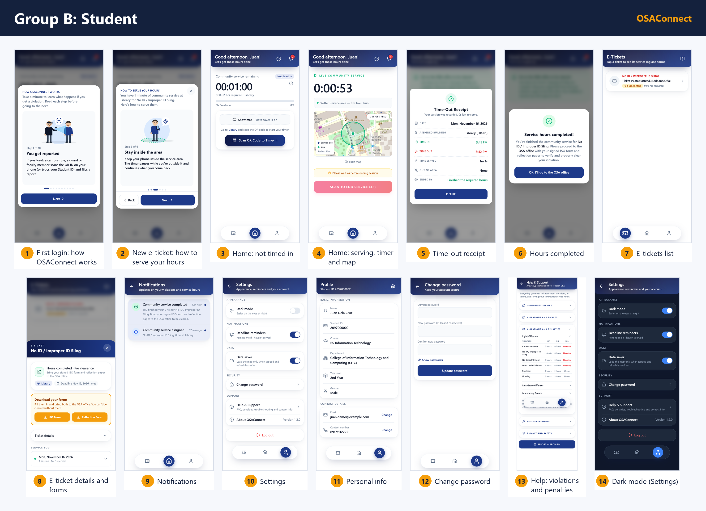

# Group B: Student

(1) The first time a student logs in, a short walkthrough explains how OSAConnect works, step by step. (2) When OSA approves a violation and gives the student community service, a guide shows how many hours they have, where to serve them, and how to serve them. (3) The home screen shows the time remaining, the assigned building and a button to scan the site's QR code; here the student has not timed in yet. (4) After scanning the QR code at the building, the timer runs, and the map shows the student inside the service area (the timer pauses if they leave it). (5) When the session ends, a time-out receipt shows the date, building, time in, time out and time served, and (6) when all the hours are done, the student is told to bring their signed ISO form and reflection paper to the OSA office. (7) The E-Tickets page lists every ticket with its status, and (8) opening one shows the hours, the deadline, the service log and the buttons to download the ISO and reflection forms. (9) Notifications tell the student when service is assigned or completed. (10) Settings has dark mode, deadline reminders, the data saver, password, and help. (11) Personal info shows the student's details and lets them change their email and contact number, and (12) Change Password lets them set a new password. (13) Help & Support answers common questions and shows the handbook's violations in a table, with the penalty for the first, second and third offense, and (14) dark mode switches the whole app to a dark theme.
