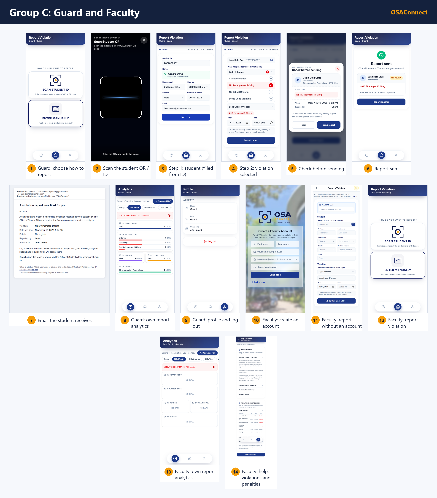

# Group C: Guard and Faculty

(1) After logging in on campus, a guard chooses how to report: scan the student's ID or type it in. (2) Scanning opens the camera to read the student's QR code or ID. (3) In step 1, the student's details are filled in from their Student ID, and (4) in step 2, the guard picks the violation from the handbook list (here, "No ID / Improper ID Sling"), with the date and time. (5) Before sending, the guard checks the summary and can still edit it, and (6) once sent, the report goes to OSA for review. (7) The student immediately gets an email saying a report was filed and that OSA will review it. (8) Guards can see analytics of their own reports (by department, violation type, gender, year level and course) and download them as a PDF, and (9) their profile shows their account and the log out button. (10) Faculty create their own account with their USTP email, which OSA confirms, or (11) report a violation without an account by confirming their USTP email with a code. (12) Logged-in faculty report violations the same way as guards, (13) see analytics of their own reports, and (14) have a Help page that explains how to file reports and shows the handbook's violations in a table, with the penalty for the first, second and third offense.
