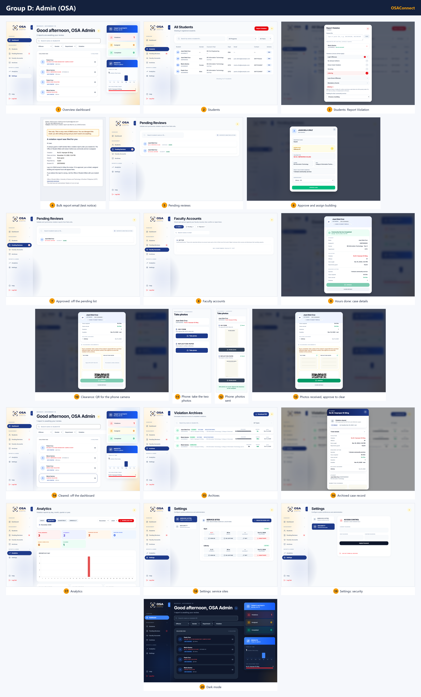

# Group D: Admin (OSA)

(1) The admin's overview dashboard greets the OSA staff member, shows how many reports are waiting, lists the violators with their status and building, and summarizes today's violations, assignments, completions and top violations. (2) The Students page lists every registered student, and (3) its Report Violation window lets the admin report one or many students at once by Student ID, choosing the violation from the handbook list. (4) Students reported this way get an email; while the system is being tested, these bulk emails start with a notice that it is only a test and can be disregarded. (5) Pending Reviews lists the reports from guards and faculty, and (6) opening one shows the student, the violation, the offense number and the penalty from the handbook, where the admin assigns a building and approves the case. (7) Once approved, the report leaves the pending list (the one left here is a different test report). (8) Faculty Accounts is where OSA confirms or rejects faculty who signed up or reported without an account. (9) When a student finishes their hours, their case is marked "for clearance," and (10) the admin opens a QR code to take photos with a phone. (11) On the phone, the admin photographs the signed ISO form and the reflection paper, and (12) sends both photos. (13) The photos appear on the computer and the admin approves the clearance, and (14) the case leaves the dashboard. (15) Archives keeps every completed case and can be downloaded as a PDF log, and (16) each archived record shows the full case history. (17) Analytics shows reports by day, month, quarter or year and can be downloaded as a PDF. (18) In Settings, Service Sites is where buildings are registered with their GPS location, radius and capacity, and their QR posters are printed, and (19) Security is where the admin changes their password. (20) The admin pages also have a dark mode.
